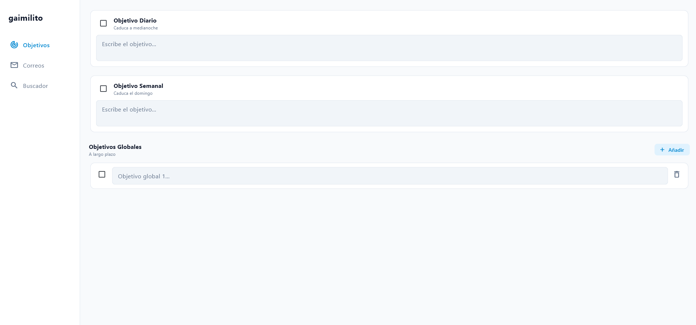
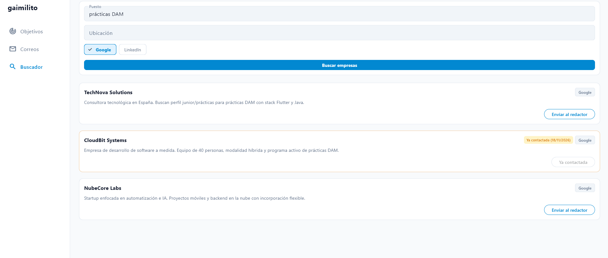
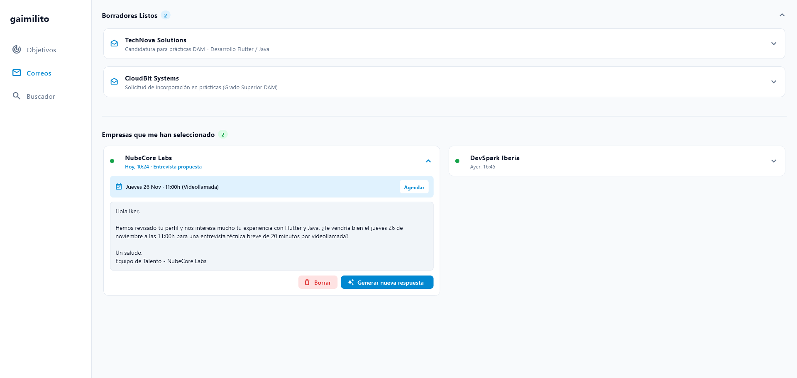
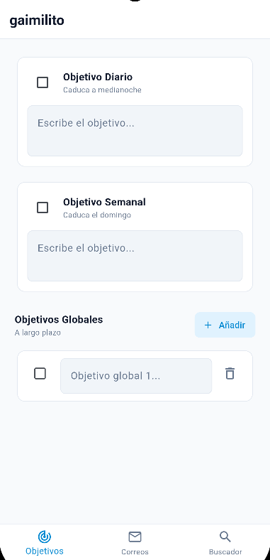

# gmAIl


-success?style=for-the-badge)

Cross-platform personal productivity, assistant, and automated job-search application for **Android** and **Windows**, built with a 100% free-tier architecture.

## Key Features

- **Adaptive Multiplatform UI (60-30-10 Design):** Minimalist interface with `BottomNavigationBar` on Android and navigation sidebar on Windows, centralized in `lib/app_colors.dart`.
- **Goal Tracking (`lib/objetivos_view.dart`):** Daily Goal (auto-resets at midnight), Weekly Goal (auto-resets on Sunday), and dynamic Global Goals management.
- **Job Search & Anti-Duplicate Control (`lib/buscador_view.dart`):** Filter opportunities by role, location, and source (Google/LinkedIn) with duplicate-contact protection.
- **Drafts & CRM (`lib/correos_view.dart`):** Expandable editable email drafts (*Approve & Send* / *Discard*) and responsive grid for positive company replies with interview detection and Google Calendar scheduling.

## Screenshots

| Desktop (Windows) — Goals & Sidebar | Desktop (Windows) — Job Search |
| :---: | :---: |
|  |  |

| Desktop (Windows) — Drafts & CRM | Mobile (Android) — Adaptive UI |
| :---: | :---: |
|  |  |

## Project Structure

```text
lib/
├── main.dart            # Adaptive layout (BottomNavigationBar on Android / Sidebar on Windows)
├── app_colors.dart      # Centralized 60-30-10 color palette & status tokens
├── objetivos_view.dart  # Daily, Weekly & dynamic Global Goals management
├── buscador_view.dart   # Job search filters & anti-duplicate contact control
└── correos_view.dart    # Editable email drafts & selected companies CRM grid
```

## Getting Started (Local Frontend Preview)

```bash
git clone https://github.com/ikercruzadojimenez/gmAIl.git
cd gmAIl
flutter pub get
flutter run